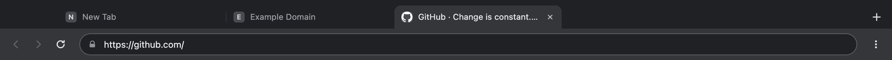
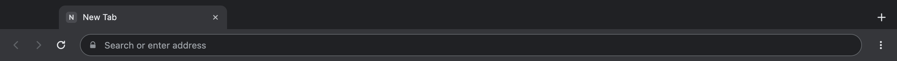

# Browser Shell

A Chrome-like desktop browser shell built with **Electron**, using the modern
view architecture (`BaseWindow` + `WebContentsView`) instead of the deprecated
`BrowserView` or the discouraged `<webview>` tag.

Every tab is a real Chromium `webContents` in its own renderer process — not an
`iframe`. That means arbitrary sites load (no `X-Frame-Options` / CSP walls),
each tab has a full browser context, and `window.open` popups (OAuth, payments)
behave the way they do in Chrome.





## What's in the box

| Feature | Status |
| --- | --- |
| Tab strip with favicon, title, loading spinner, close button, middle-click close | ✅ |
| Omnibox: URLs, bare domains, `localhost:3000`, IPs, or search (DuckDuckGo) | ✅ |
| Back / forward / reload-stop, live sync with the page | ✅ |
| Real browser tabs (independent renderer per tab, kept alive when switching) | ✅ |
| Shared persistent session — logins and cookies carry across tabs and windows | ✅ |
| `target=_blank` opens a tab; `window.open` popups get a native window sharing the same session (OAuth works) | ✅ |
| Native context menu (open link in new tab, copy link, back/forward, inspect element) | ✅ |
| Keyboard shortcuts: `⌘/Ctrl+T`, `⌘/Ctrl+W`, `⌘/Ctrl+L`, `⌘/Ctrl+R`, `⌘/Ctrl+Shift+R`, `⌘/Ctrl+←/→`, `Ctrl+Tab` | ✅ |
| Session restore: open tabs come back on the next launch | ✅ |
| Frameless shell chrome: macOS traffic lights inset, Windows/Linux `titleBarOverlay` | ✅ |
| Headless smoke test that drives the app and writes screenshots | ✅ |

## Requirements

- Node.js ≥ 20 (tested on Node 26 / Electron 45)
- macOS 12+, Windows 10+, or a modern Linux desktop

## Prebuilt demo (macOS arm64)

Grab the zip from [Releases](https://github.com/zccz14/electron-browser-shell/releases/tag/v0.1.0),
unzip, and open `Browser Shell.app` — no Node.js needed. The build is ad-hoc signed
(not notarised), so if a browser set the quarantine flag:

```bash
xattr -dr com.apple.quarantine "/Applications/Browser Shell.app"
```

## Run it

```bash
git clone https://github.com/zccz14/electron-browser-shell.git
cd electron-browser-shell
npm install
npm start
```

### If the Electron binary download stalls

`npm install` fetches the Electron binary from GitHub releases. On a slow or
restricted network, point npm at a mirror first:

```bash
export ELECTRON_MIRROR=https://npmmirror.com/mirrors/electron/
npm install
```

(or put `electron_mirror=https://npmmirror.com/mirrors/electron/` in `~/.npmrc`)

## Build a .app yourself

```bash
npm install
./scripts/package-mac.sh      # -> dist/Browser Shell.app (ad-hoc signed)
```

## Smoke test

Runs the real app, opens tabs, navigates, goes back, closes a tab, resizes the
window, asserts the layout, and writes PNG screenshots — no display required:

```bash
npx electron . --smoke --smoke-out=/tmp/browser-shell-smoke
```

Exit code `0` means every assertion passed. Artefacts land in the output dir:

```
01-new-tab.png   shell UI, new tab page
02-tabs.png      three tabs, real titles + favicons
03-active-tab.png  the active tab's page
04-after-back.png  after back navigation
05-resized.png   after window resize
report.json      full state dumps + failures
```

## Architecture

```
src/
├── main/
│   ├── index.js     app lifecycle, BaseWindow, chrome view, IPC
│   ├── tabs.js      TabManager — one WebContentsView per tab
│   ├── menu.js      app menu (the accelerators are the shell's shortcuts)
│   ├── urls.js      omnibox input → URL / search
│   └── smoke.js     self-check + screenshots
├── preload/
│   └── chrome.js    contextBridge: the only shell ⇄ main surface
└── renderer/
    ├── index.html   tab strip + toolbar (this *is* the browser UI)
    ├── styles.css
    ├── app.js
    └── newtab.html  local new tab page (works offline)
```

Two layers, and that is the whole trick:

1. **The shell UI** is an ordinary web page in its own `WebContentsView`, pinned
   to the top of the window (`CHROME_HEIGHT = 88px`). Because it is your DOM,
   it can look exactly like Chrome — rounded tabs, hover states, whatever.
2. **The page area** is a stack of `WebContentsView`s, one per tab, laid out
   below the chrome with `setBounds()`. Switching tabs re-attaches a view
   instead of reloading it, so background tabs keep their state.

IPC is deliberately small: the chrome page calls
`shell.newTab() / navigate() / activateTab() / …`, and the main process pushes
the whole tab list back on every change (`shell:state`).

## Platform notes

**macOS** — `titleBarStyle: 'hiddenInset'` with `trafficLightPosition`, so the
traffic lights sit inside the tab strip. The tab strip starts at 84px so it
never collides with them. Primary target, tested on macOS 26 (Apple silicon).

**Windows** — `titleBarStyle: 'hidden'` + `titleBarOverlay`, so the native
minimise/maximise/close buttons are drawn over the shell UI; the tab strip
reserves 148px on the right for them. Not yet run on a Windows box in this
repo's smoke test — PRs welcome.

**Linux** — same code path as Windows (overlay title bar). Needs a desktop with
a compositor; `WebContentsView` positioning is done by Electron, so it is not
tied to any toolkit-specific layout.

## Known limits (v0.1)

- The shell UI is only 88px tall, so autocomplete dropdowns that would overlap
  the page are not implemented yet. The `⋯` button opens a native menu instead.
- Tabs are not draggable for reordering; there is no tab suspension yet, so ten
  tabs cost ten renderers' worth of memory (roughly 1.5–3 GB in practice).
- No bookmarks, no history page, no downloads UI, no per-site zoom.
- Session restore keeps `http(s)` URLs only.

## License

MIT
